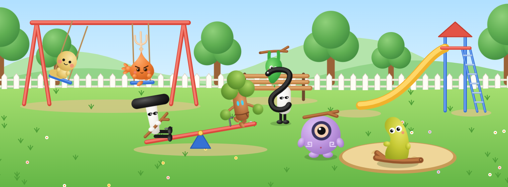

# Hanzi Playground

The eight Hanzi Heroes — 一 丁 上 下 木 人 乙 又 — at play in an animated SVG playground.

The heroes wander around, sit on the grass and the bench, ride the swings and seesaw, go down the slide and chase each other. No hero has a fixed job: each one picks its next activity at random. Click a hero to make it hop.

## Run it

Open `index.html` in any modern browser. It is a single file with no build step and no dependencies.

Add `?lineup` to the address to see the whole cast standing in a row.

Live at **https://lokzzstudio.github.io/Hanzi_Playground/**

## Publishing

Every push to `main` deploys the repo to GitHub Pages through `.github/workflows/static.yml`. Under **Settings → Pages**, **Source** must be set to *GitHub Actions*.

## How it is built

- The characters are hand-written SVG with radial-gradient shading to give a clay look. Each character is one entry in the `HEROES` array in `index.html`, with its origin at the feet.
- A small state machine (`idle`, `walk`, `sit`, `chase`, `flee`, `use`) drives each hero. Swings, seesaw ends, bench seats and the slide are *slots*: a hero claims a free slot, walks to it and rides it.
- Heroes and equipment are sorted by their ground line on every frame, so nearer things draw in front.
