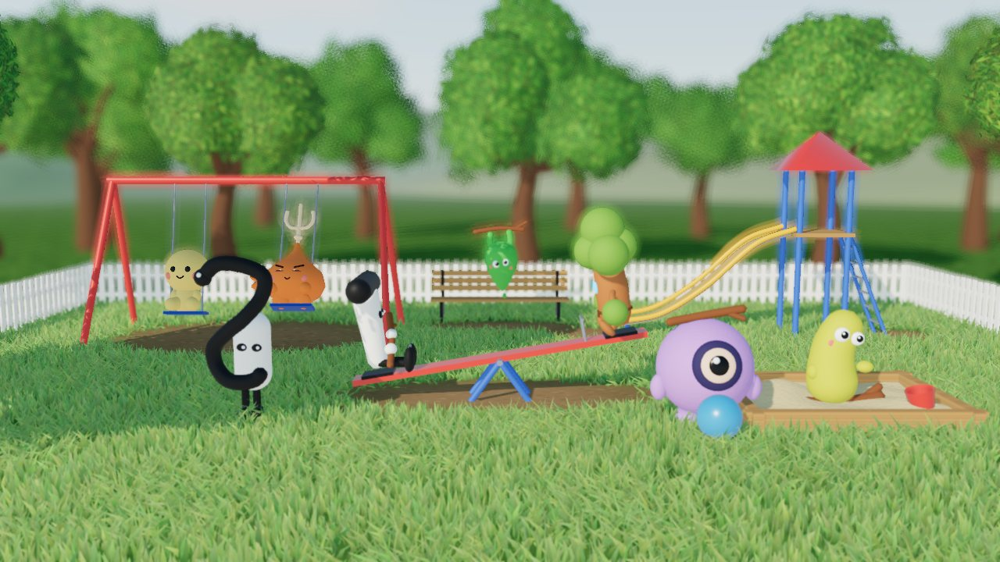

# Hanzi Playground

The eight Hanzi Heroes — 一 丁 上 下 木 人 乙 又 — at play in a playground, in a 2D, a 3D and a 2.5D version.

The heroes wander around, sit on the grass and the bench, ride the swings and seesaw, go down the slide and chase each other. No hero has a fixed job: each one picks its next activity at random. Click a hero to make it hop.

Live at **https://lokzzstudio.github.io/Hanzi_Playground/**

## Pages

| File | What it is |
| --- | --- |
| `index.html` | Entry page: choose the 2D, 3D or 2.5D version. |
| `2d.html` | Flat illustrated playground in SVG. One self-contained file with no dependencies. |
| `3d.html` | 3D park built with three.js. Drag to look around, scroll to zoom. |
| `hybrid.html` | 2.5D version: an illustrated SVG backdrop with real-time 3D clay heroes standing in it. Light enough for phones. |

## Run it

Open `index.html` in any modern browser. There is no build step.

The 3D and 2.5D versions load three.js from the jsDelivr CDN, so they need an internet connection. The 2D version works offline.

Add `?lineup` to the address of any version to see the whole cast standing in a row.

## Publishing

Every push to `main` deploys the repo to GitHub Pages through `.github/workflows/static.yml`. Under **Settings → Pages**, **Source** must be set to *GitHub Actions*.

## How it is built

All versions share the same behaviour. A small state machine (`idle`, `walk`, `sit`, `chase`, `flee`, `use`) drives each hero. Swings, seesaw ends, bench seats and the slide are *slots*: a hero claims a free slot, walks to it and rides it.

**2D** — The characters are hand-written SVG with radial-gradient shading for a clay look, one entry each in the `HEROES` array. Heroes and equipment are sorted by their ground line on every frame, so nearer things draw in front.

**2.5D** — Two layers share one 1600×900 box and one fit rule. Underneath, an inline SVG paints the static scenery (sky, hills, trees, fence, lawn, sandbox, cast shadows). On top, a transparent three.js canvas with an orthographic camera maps one world unit to one SVG pixel. The heroes are the 3D clay models from the 3D version. Each piece of equipment is drawn as SVG, rasterised once into a texture and stood on a flat plane, so swings and the seesaw pivot in the screen plane. Everything is painter-sorted by ground line as in 2D: each sprite gets a `renderOrder`, and the depth buffer is cleared between sprites so heroes never intersect each other or the equipment. There are no shadow maps or post-processing, and the pixel ratio is capped at 2.

**3D** — Everything is generated in code; there are no model or image files.

- Each hero is modelled from spheres, lathe shapes and swept limbs in a matte clay material, one entry each in the `HEROES` array.
- The scene is lit by a physical sky and a late-afternoon sun with soft shadows. Grass is about 100,000 blades that sway in the wind; trees are leaf cards that cast dappled shade.
- A depth-of-field pass keeps the playground sharp and softens the distance.
- Phones and other touch devices start on a lighter profile: fewer grass blades and leaves, a smaller shadow map, lower resolution and no depth of field. Add `?lite` or `?full` to the address to force one profile or the other.
- If the frame rate drops, the page lowers its own quality in steps: resolution first, then depth of field, grass density and finally shadows. Add `?fixed` to the address to turn that off.
- On a portrait screen the camera moves back and looks from higher up so the whole playground fits.
- While the scene loads it names the step it is on, and if it cannot start it shows the reason and a link to the 2D version.
- Crash guard: each loading step is saved in the browser. If a visit dies before the scene has run for a few seconds, the next visit starts one profile lower (full, then lite, then safe), shows where the last one stopped, and remembers the lower profile. Safe mode has no shadows, a plain sky and little grass. If safe mode also dies, the page asks before trying again. Add `?safe` to force safe mode, or `?reset` to forget a remembered downgrade.
